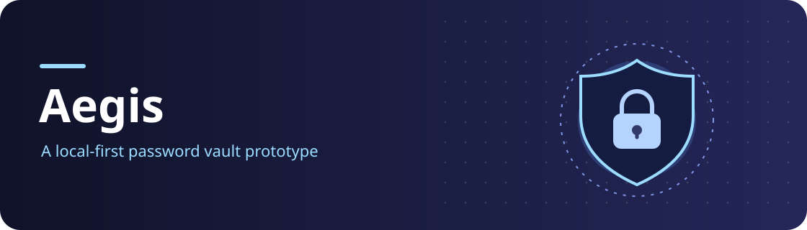

<h1 align="center">🔐 Aegis Password Manager</h1>

<p align="center"><strong>A local-first web vault and self-hosted sync prototype.</strong></p>

<p align="center">
  
</p>

<p align="center"><a href="#what-is-in-this-repository">What is in this repository</a> · <a href="#run-the-web-app-locally">Run the web app locally</a></p>

## What is in this repository

| 🔐 Web vault | 🔄 Optional backend | 🧭 Platform roadmap |
| --- | --- | --- |
| [Manage and search local vault entries](apps/web/src/main.jsx) | [Self-host account and encrypted sync storage](server/README.md) | [See planned desktop, mobile, and browser targets](docs/FEATURES.md) |

## Run the web app locally

```sh
cd apps/web
npm install
npm run dev
```

> [!IMPORTANT]
> Use sample entries while evaluating this prototype. An independent security audit is pending.

[Backend setup](server/README.md) · [Database design](docs/DATABASE.md) · [Threat model](docs/THREAT_MODEL.md) · [Security policy](SECURITY.md)
