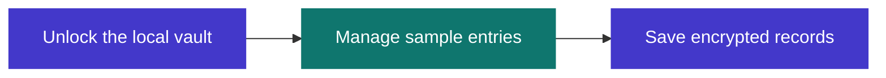

<h1 align="center">🔐 Aegis Password Manager</h1>

<p align="center"><strong>A local-first web vault and self-hosted sync prototype.</strong></p>

<p align="center">
  
</p>

<p align="center"><a href="#what-is-in-this-repository">What is in this repository</a> · <a href="#run-the-web-app-locally">Run the web app locally</a> · <a href="#project-reference">Project reference</a></p>

## What is in this repository

| 🔐 Web vault | 🔄 Optional backend | 🧭 Platform roadmap |
| --- | --- | --- |
| [Manage and search local vault entries](apps/web/src/main.jsx) | [Self-host account and encrypted sync storage](server/README.md) | [See planned desktop, mobile, and browser targets](docs/FEATURES.md) |

## Run the web app locally

```sh
cd apps/web
npm install
npm run dev
```

> [!IMPORTANT]
> Use sample entries while evaluating this prototype. An independent security audit is pending.

[Backend setup](server/README.md) · [Database design](docs/DATABASE.md) · [Threat model](docs/THREAT_MODEL.md) · [Security policy](SECURITY.md)

## Project reference

<details>
<summary><strong>🔐 Vault, sync, and security details</strong></summary>

Aegis is a local-first password manager prototype. This repository contains a React web vault, a self-hosted account and sync API, and documentation for future native apps and browser extensions.

## What is in this repository details



| Area | Implementation |
| --- | --- |
| [Web vault](apps/web/src/main.jsx) | Vault creation and unlock, login records, search, and password generation |
| [Vault storage](apps/web/src/vaultCrypto.js) | Browser-side encryption and IndexedDB persistence, with support for encrypted sync envelopes |
| [API](server/README.md) | Account and session endpoints backed by PostgreSQL, with server-side storage for encrypted vault data |
| [Platform targets](docs/FEATURES.md) | Web, Android, iOS, desktop, browser extension, and CLI roadmap |

---

## Run the web app locally details

Install Node.js and npm, then run these commands from the repository root.

```sh
cd apps/web
npm install
npm run dev
```

Open the URL printed by Vite. Use sample entries to try the vault creation, lock and unlock, search, and password generator. Run `npm run build` to create a web build.

---

## Run the optional backend

**Backend references**

| Area | Start here |
| --- | --- |
| Startup | [Server setup](server/README.md) |
| Storage | [Database design](docs/DATABASE.md) |
| Security boundaries | [Threat model](docs/THREAT_MODEL.md) |

The backend uses PostgreSQL and can be run with [Docker Compose](docker-compose.yml). See [server setup](server/README.md) for environment and HTTPS configuration, and [the database guide](docs/DATABASE.md) for the storage model. Production email delivery for verification and password resets still requires integration.

---

## Security and project status

> [!IMPORTANT]
> Use sample entries for testing. An independent security audit is pending.

Aegis is under active development. Use test data while trying the prototype. An independent security audit is pending. The [security policy](SECURITY.md) covers reporting and release gates, and the [threat model](docs/THREAT_MODEL.md) describes the intended client-side encryption boundary.

</details>
